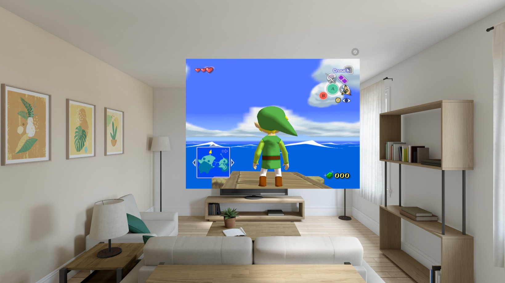
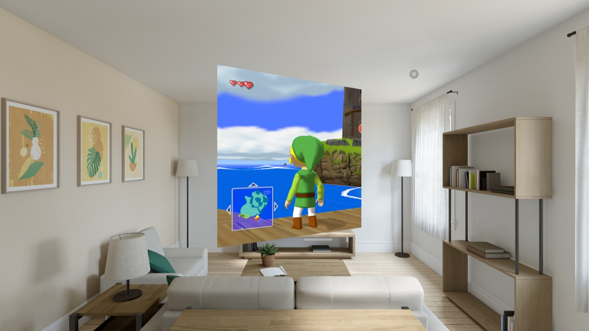

<p align="center">
  <a href="https://trevorbilt.com"></a>
</p>

<h1 align="center">Wind Waker VR for Apple Vision Pro</h1>

<p align="center"><b>The Great Sea, in real depth.</b></p>

<p align="center">
  
  <br><sub>The Window view in 3D, in the visionOS Simulator's living room.</sub>
</p>

*The Legend of Zelda: The Wind Waker* (GameCube, 2002) running natively on Apple Vision Pro, in a
window beside your other apps. It isn't a flat picture in a frame: the game's 3D scene is rebuilt
behind the glass every frame, so Outset's cliffs, the pier and Link himself have real depth, and you
can lean to see past the window's edge. No PC, no streaming: just the headset.

Wind Waker VR is [Trevorbilt](https://trevorbilt.com)'s native visionOS port of
[SwitchWaker](https://github.com/centollOS/SwitchWaker), which compiles zeldaret's
[decompilation](https://github.com/zeldaret/tww) natively on encounter's
[Aurora](https://github.com/encounter/aurora). You bring the disc, you build the app, the King of Red
Lions does the rest.

> [!IMPORTANT]
> There are no game files and no app download here. You need your own copy of the game (the
> GameCube disc, USA) and a Mac to build with. Wind Waker VR is a fan project. It isn't affiliated
> with or endorsed by Nintendo.

## What you get

- **The Window view, in 3D.** The game plays with its own camera, and the world behind the glass
  keeps its true shapes. The ground at the window's foot sits on the glass, the way it would
  through a real window, so nothing bends as the camera moves.
- **Or in 2D, like the original.** The button above the window's corner (or L1 and Create together
  on a gamepad) flattens it back to the GameCube's own picture, and back again.
- **A controller you already have.** A DualSense, an Xbox pad or any other gamepad, or both PS VR2
  Sense controllers held as one. The camera turns the modern way by default; the Controls tab has
  the GameCube's way round, and inverted up and down.
- **Saves, as they always were.** Save from the game's own menu; your saves stay on the headset
  between updates.
- **Full and Progressive, if you're feeling brave.** First-person VR is in the app too, behind an
  experimental switch: it runs in the Simulator, but it hasn't been played on a headset yet (more
  under [Experimental](#experimental-full-and-progressive)).

<p align="center">
  
  <br><sub>Windfall's dock, from off to one side (Simulator again). That's real depth back there, not a picture.</sub>
</p>

## What you'll need

- **A headset:** Apple Vision Pro with visionOS 26 or later. It's played on visionOS 27.
- **A Mac** with Apple silicon and Xcode at `/Applications/Xcode.app` (a path with a space in it
  trips up CMake), with its visionOS platform installed. Built and tested with Xcode 27.1 on
  macOS 27.
- **Some tools:** [Homebrew](https://brew.sh), then `brew install cmake ninja xcodegen python rustup`,
  and the Rust nightly the build pins (the [install guide](AVP-INSTALL.md#requirements) has the
  lines).
- **An Apple Account**, signed in to Xcode (Xcode › Settings › Accounts). The app asks for the
  increased memory limit; it's been built with a paid developer team, and whether a free account
  can sign it is untested.
- **The game:** your own disc image of the USA release, **GZLE01, revision 0**, as an uncompressed
  `.iso`.
- **Patience:** about 5 GB of free disk, and an hour or two for the first build (it builds Dawn, the
  graphics layer, once, then the whole game). Later builds take minutes.

First time running your own app on a Vision Pro? Pair it with Xcode (Window › Devices and
Simulators) and turn on [Developer Mode](https://developer.apple.com/documentation/xcode/enabling-developer-mode-on-a-device)
on the headset. Apple's [guide to running on a device](https://developer.apple.com/documentation/xcode/running-your-app-on-simulated-or-physical-devices)
walks through both.

## Build it

1. **Get the code.**

   ```bash
   git clone https://github.com/edgytoast/windwaker-visionos.git windwaker-visionos
   cd windwaker-visionos
   ```

2. **Generate the game's asset headers from your disc, once.** The game's code includes data
   generated from the disc, so the build makes it on your Mac (into `build/`, which git ignores) and
   it never leaves there:

   ```bash
   COS_DISC=/path/to/your/GZLE01.iso native/tools/gen_assets.sh
   ```

3. **Build and install.** With the headset awake, unlocked and paired:

   ```bash
   visionos/scripts/build-visionos.sh --team YOURTEAMID --install
   ```

   Your team ID is the 10-character ID shown for your team in Xcode › Settings › Accounts.

The full install guide, including everything the build does on your Mac, is
[AVP-INSTALL.md](AVP-INSTALL.md).

Fancy the visionOS Simulator instead? `visionos/scripts/build-visionos.sh --simulator` builds it
unsigned. It's great for poking around, and terrible at judging looks: its GPU isn't the headset's.

## Bring your game

Wind Waker VR plays your own disc image of the USA release, **GZLE01, revision 0** (the original,
not a later revision, the European or Japanese disc, or the Wii U's HD remaster), as an
uncompressed `.iso`. A compressed `.rvz` or `.ciso` needs converting first (Dolphin can do it:
right-click the game, Convert File, ISO). [Dolphin's guide](https://wiki.dolphin-emu.org/index.php?title=Ripping_Games)
explains how to dump your disc. Any of these get it onto the headset:

- **AirDrop** it to your Vision Pro and choose **Wind Waker VR** to open it with.
- **From Files:** put it anywhere Files can reach, then tap **Import** in the app.
- **By hand:** copy it into the app's own folder in Files (On My Apple Vision Pro › Wind Waker VR).

The launcher checks the disc and tells you if it's another region or revision. Then tap **Play**.

## Play

The launcher has four tabs. **Play** has your disc and Play. **Controls** draws whatever you're
holding (Sense controllers, a DualSense-style or Xbox-style pad) with every button labelled, and has
the camera's directions. **Ports** browses the [AVP Ports Index](https://github.com/edgytoast/avp-ports-index)
for more games. **About** has the credits, licences and an update check.

The Window view plays like the original game, so it needs a controller: visionOS gives apps no hand
tracking outside Full and Progressive. Look at the game's window to give it your controller (visionOS
hands a controller to whichever window you're looking at).

| Does | Gamepad | Sense controllers |
|---|---|---|
| Move | Left stick | Left stick (click: the small map) |
| Camera | Right stick | Right stick (click: close the map) |
| Action: talk, open, climb, roll | A | Cross |
| Sword (hold to spin) | B | Circle |
| Items on X and Y | X, Y | Square, Triangle |
| Item on Z | Right shoulder | R1, the right grip |
| Target | Left trigger | L2 |
| Shield | Right trigger | R2 |
| Items menu | Menu | Options |
| Maps | D-pad (up: the map; left and right: the small map) | L1 (the map), Create (the small map) |
| 2D or 3D | L1 + Create (LB + View) | the button above the window's corner |

**Saving works the way it always did,** from the game's own menu. Close the window to quit; your
progress is what you last saved.

## Experimental: Full and Progressive

Full puts the Great Sea all around you, in first person: your head is Link's, a swing of your sword
hand is the sword, and the shield goes in the other. Progressive is the same through a portal the
Digital Crown widens and narrows. They play with PS VR2 Sense controllers, your bare hands or a
gamepad, and the Digital Crown pauses them.

They're built and run in the Simulator, but they haven't been played on a headset yet. Stereo,
comfort, frame rate, the hands and the Sense controllers are all untested there. If you'd like to
try them anyway, turn on **Try Full and Progressive (experimental)** under the cards on Play, take it
slow, and stop if anything feels off. The Controls tab then shows their buttons and gestures, and
**Advanced** has turning (smooth or in steps), the sword hand, render resolution and anti-aliasing.
[Reports](https://github.com/edgytoast/windwaker-visionos/issues) of how it went are very welcome.

## Update

Get the new code, then build and install again. If you came from the AVP Ports Index, run
`git fetch`, then `git checkout` the commit Wind Waker VR's page there lists now (that's the code it
scanned). If you cloned the `visionos` branch, `git pull`. Then:

```bash
visionos/scripts/build-visionos.sh --team YOURTEAMID --install
```

Your disc and saves stay on the headset, and the asset headers stay in `build/`. The app's About
tab says when a newer version is out.

## Known issues

- The 3D window shows a little less at its sides than the 2D picture: it frames the world the way a
  real window would from where you sit, so wide side views (the pier from Outset's ledge, say) can
  fall outside it. 2D shows all of it.
- What comes very close to the game's camera is cut at the window's front, the way a camera's near
  plane cuts, rather than poking out of the glass.
- Torch flames look a little redder than on the GameCube, and the Forsaken Fortress at night looks
  washed out in 3D (2D shows it as it should).
- The first build is long, and it needs the network (Dawn, Aurora, the decompilation's tools and the
  Rust crates are downloaded at pinned versions).

Found something else? [Report a problem](https://github.com/edgytoast/windwaker-visionos/issues) (the About tab links
there too).

## Credits

- **[Trevorbilt](https://trevorbilt.com)**: the Apple Vision Pro port: the visionOS app and its
  launcher, the 3D window and its scene mirror, Full and Progressive, the input and the build.
- **[SwitchWaker](https://github.com/centollOS/SwitchWaker)** (Pulpparty, depende3000 and the
  SwitchWaker contributors): the native port of the decompilation on Aurora, for the Mac, Linux and
  the Switch. This port builds directly on it; its own README is [SWITCHWAKER.md](SWITCHWAKER.md).
- **[zeldaret/tww](https://github.com/zeldaret/tww)**: the community decompilation of the game,
  with [snrubrm/tww](https://github.com/snrubrm/tww) completing the functions still missing.
- **[encounter/aurora](https://github.com/encounter/aurora)**: the GameCube SDK over WebGPU, which
  draws the game and reads the controllers.
- **Twilight Princess VR**: the window's scene mirror, the stereo view and the VR hooks follow
  [JoeyAW's TPVR](https://github.com/JoeyAW/TPVR) and Trevorbilt's
  [visionOS port of it](https://github.com/edgytoast/tpvr-visionos), on Twilit Realm's
  [Dusklight](https://github.com/TwilitRealm/dusklight).
- **[iChris4/Wiicompiled_VR](https://github.com/iChris4/Wiicompiled_VR)**: WiiCompiled Vision, the
  source of the visionOS OpenXR provider.
- **[Dolphin](https://dolphin-emu.org)**: its DSP plays the game's audio, through elliotttate's
  adapter from [Wind Waker Recomp](https://github.com/elliotttate/Wind-Waker-Recomp).

*The Legend of Zelda: The Wind Waker* is Nintendo's. This project isn't affiliated with or endorsed
by Nintendo, and none of the game's files are in the app or the repository.

## Licences

- Trevorbilt's code for the port and SwitchWaker's own code: **MIT** ([LICENSE](LICENSE)).
- `game/`, the decompilation: **CC0-1.0** ([game/LICENSE](game/LICENSE)).
- `native/dsp_hle/`, the audio over Dolphin's DSP: **GPL-2.0-or-later**.
- `visionos/openxr-provider/`, from WiiCompiled Vision: **GPL-3.0-or-later**. The app links it, so
  **the app you build is GPL-3.0**; About links the source of each build.
- `visionos/TrevorbiltKit/`, the launcher Trevorbilt's ports share: MIT, with its fonts under the SIL
  Open Font License 1.1. Trevorbilt's name, badge and app icons aren't covered by these licences.

[THIRD_PARTY.md](THIRD_PARTY.md) lists every component and its licence.

If you enjoy it, the rest of what I make is at [trevorbilt.com](https://trevorbilt.com), and the
[Ports tab](https://github.com/edgytoast/avp-ports-index) has more games for your Vision Pro.
